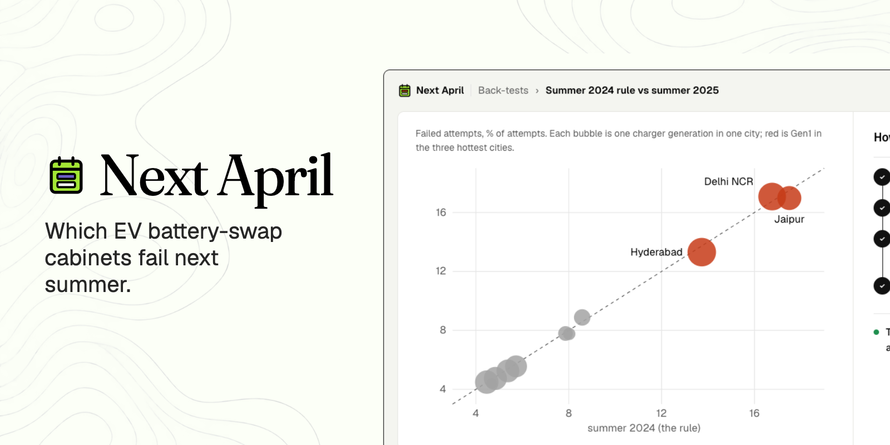
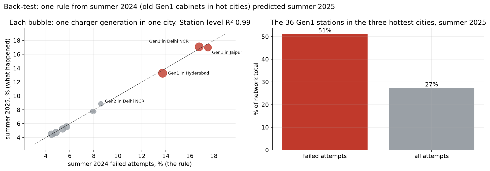
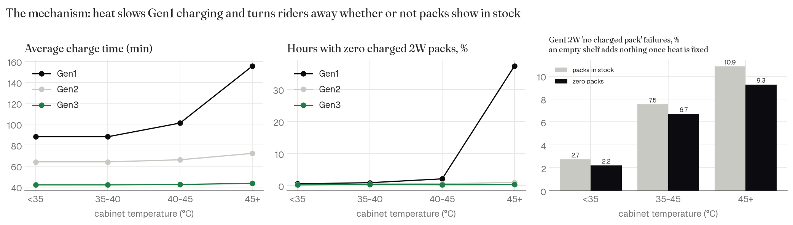
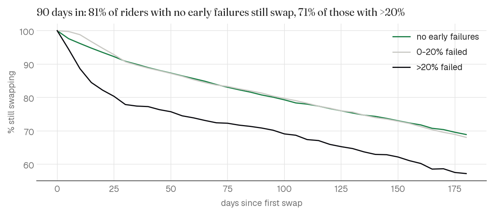

# Next April

The same 36 old battery-swap cabinets will fail again next summer (April to June 2026; the data runs from January 2024 to June 2025). VoltRelay, a battery-swap network for delivery riders in six Indian cities, is choosing between four budget proposals: more stations, more batteries, network-wide peak pricing, and an exclusive deal with its largest fleet partner, ZipDrop. This analysis shows which stations fail, why (the old cabinets overheat; it is not a shortage of stations or packs), and what to fund instead.

One rule from summer 2024 (each station gets the failure rate of its charger generation in its city) predicted each station's summer 2025 failure rate, for the 90 stations open both summers, with an out-of-sample R² of 0.990 (scored station by station; the chart groups stations by generation and city). The 36 Gen1 stations, the oldest cabinet generation, in Jaipur, Delhi NCR and Hyderabad handled 27.4% of summer 2025 attempts and produced 51.2% of its failed attempts.

**Chart 1: the same stations fail every summer.** Each bubble is one charger generation in one city; red is Gen1 in the three hottest cities. Summer 2024 on the x-axis predicts summer 2025 on the y-axis.

**Chart 2: why.** Only Gen1 cabinets slow down as they heat up; at the same temperature, an empty cabinet turns riders away no more often than a stocked one, so the fix is the cabinet.

**Chart 3: what it costs riders.** New riders who hit failed swaps early stop swapping within their first month.

**Run it in about two minutes:** [open the notebook in Google Colab](https://colab.research.google.com/github/kinnuworks/next-april/blob/master/notebooks/next_april.ipynb) and choose Runtime → Run all. It downloads the organiser's eight CSV files itself and runs top to bottom. If Google Drive blocks the download ("too many users have downloaded this file"), open the organiser's data folder in Drive, choose Organise → Add shortcut to My Drive, and run again: the notebook mounts your Drive and reads the files from the shortcut.

**See it live:** [next-april-six.vercel.app](https://next-april-six.vercel.app), the one-page briefing with a station explorer.

**Read it in five:** [`report/Next_April_report.pdf`](report/Next_April_report.pdf).

## What drives what (primary vs secondary)

| Outcome | Primary driver | Secondary |
|---|---|---|
| Service failures | **Old Gen1 cabinets overheating** in Jaipur, Delhi NCR and Hyderabad: 51.2% of summer failures from 27.4% of attempts. Inside the cabinet at 45°C or more, a Gen1 cabinet takes 156 minutes to charge a pack instead of 88; Gen3 still takes 43. The same Gen1 cabinet has 1.45 times the odds of a failed attempt in its own hot hours; Gen3 does not get worse | Evening rush after hot days; 3W riders. Not the cause: empty shelves (at the same station and cabinet temperature, a cabinet with no charged packs turns riders away no more often) |
| New-rider churn | Failed swaps in the first 14 days (33.2% churn above 20% failures vs 13.3% with none; odds ×1.41 per 10 points) and partner-billed plans | Kyron packs, a summer start; queue time not significant |
| Margin per swap | Battery wear from Kyron, the new pack supplier: 3.22 times other packs, ₹4.35 crore extra | ZipDrop's 12% → 28% discount: ₹11.78 less per swap than other partners, ₹39.6 lakh |

## What to fund, ranked, with what each is worth

| # | Action (owner) | Replaces proposal | Effect | Confidence |
|---|---|---|---|---|
| 1 | Fix the 36 Gen1 cabinets: replace with Gen3, or retrofit cooling if it matches Gen3's charge times in heat. Jaipur and Delhi NCR (23) before April 2026, then Hyderabad (13) (Network Ops) | More stations: instead of | 27,193 fewer failed attempts a summer if they ran like Gen3 in their cities, 33.3% of all summer failures | High that failures repeat |
| 2 | Stop issuing Kyron packs that the records already mark as retired; replace the Kyron 2W fleet; seek compensation from Kyron for its three lots (KY-2407/08/09) (Fleet & Procurement) | More batteries: yes, as replacement | ₹0.73 lakh of wear saved per 1,000 swaps moved off Kyron | Medium |
| 3 | Until the cabinets are fixed, on days forecast at 36°C or more, steer new riders (first 14 days) to Gen2/Gen3 (Customer Experience) | Not proposed | 330 riders lost to early failures; ₹16.4-65.4 lakh revenue if kept | Medium |
| 4 | Reopen the ZipDrop contract (Partnerships) | ZipDrop exclusive: no | Up to ₹11.78 per ZipDrop swap | High |
| 5 | Roll out peak pricing city by city, for revenue (Pricing) | Pricing rollout: yes, revenue only | ₹5.41 per swap; failures unchanged | Medium |
| 6 | Don't buy extra packs for the hot stations yet; if tried, test 63 at 6 random stations against the other 30 first (Network Ops) | More batteries: not as extra stock | Settles for ₹20.2 lakh whether a ₹1.37 crore buffer would work | Low that it helps |

Data issues handled, each with a row count and its effect on a result: test stations (62,031 rows, ₹39.3 lakh billed), firmware clock shift (139,490 rows), odometer resets (7,814 + 7,712), 21 city spellings, 9,484 mislabelled tickets, and six issues the documentation does not mention.

## Charts (each makes one point)

- `backtest.png`: the summer 2024 rule against summer 2025, by charger generation and city; the 36 hot-city Gen1 stations' share of failures vs attempts.
- `q3_mechanism.png`: as cabinets heat up, only Gen1 slows down and runs out of packs; at the same temperature, empty cabinets fail riders no more often than stocked ones.
- `q3_gen_city.png`: summer failure rate for each charger generation in each city.
- `q6_churn.png`: new riders' churn rises with their early failure rate.
- `q4_kyron.png`: Kyron packs lose health three times faster and give less range.
- `q5_partners.png`, `q5_pilot.png`: ZipDrop has the lowest margin per swap; the pilot moved demand and raised revenue.
- `expansion.png`: new stations went evenly to all cities while failures were concentrated in three.
- `q1_trends.png`, `q1_margin_parts.png`, `q2_hours.png`, `chain_leaks.png`: trends, where each swap's rupees go, failures by hour, and money lost to each problem.

## Files

- `notebooks/next_april.ipynb`: the analysis, run top to bottom (source: `notebooks/next_april.py`).
- `report/Next_April_report.pdf`: the analysis report.
- `outputs/facts.json`: every number used in the report, written by the notebook.
- `outputs/april_2026_list.csv`, `outputs/cleaning_table.csv`, `outputs/budget_verdicts.csv`, `outputs/self_audit.csv`, `outputs/charts/`.
- `tests/`: independent re-derivations of the headline numbers. `./check.sh` runs the notebook, the tests, and a check that every number in the text is in `facts.json`.

## AI use

An AI coding assistant (Claude) helped write code and draft text. Every number is computed by the notebook and checked by independent tests and a number-tracing script; see the report's AI use section.

Data: the synthetic VoltRelay dataset provided by Gradient Learnings for this hackathon.
