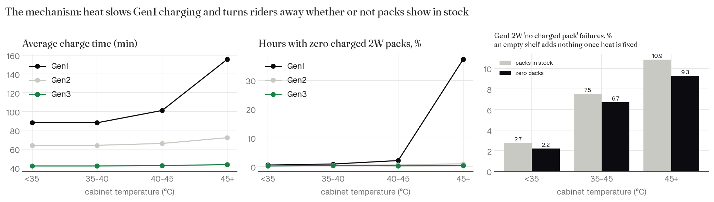
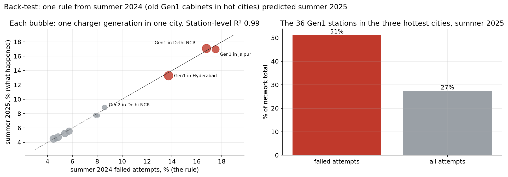
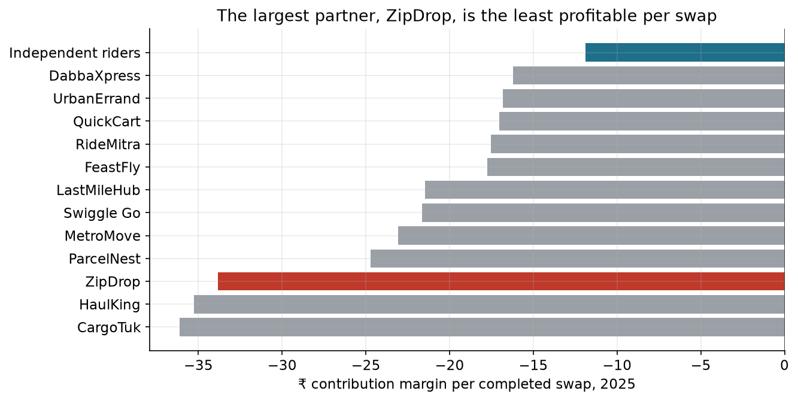
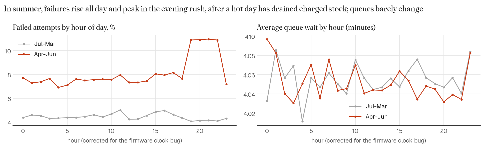
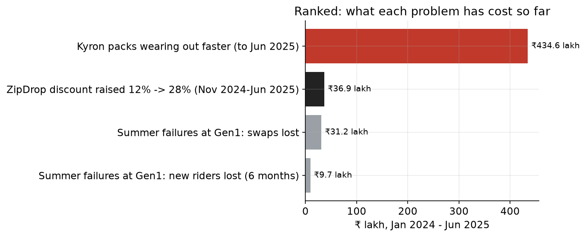

# Next April

The same 36 old swap cabinets will fail again next summer. This report shows which ones, why, and what VoltRelay should fund instead of more stations.

Dhiraj Kavuri · Gradient Learnings Data Analytics Hackathon · 15 November 2026

## The answer in one page

Every April to June, VoltRelay's oldest swap cabinets (Gen1) in Jaipur, Delhi NCR and Hyderabad overheat, charge slowly and run out of charged packs. Riders get turned away, and new riders who hit failed swaps early are the most likely to leave. A rule taken from summer 2024 alone (each station gets the summer failure rate of its charger generation in its city) predicted every station's summer 2025 rate with R² 0.991, off by 0.38 points on average. Those 36 Gen1 stations handled 27.4% of summer 2025's attempts and produced 51.2% of its failed attempts.

The 60 stations VoltRelay opened in its two expansion waves did not fix this. They were spread across all six cities, and the 36 stations failed on 15.9% of summer attempts in 2024 and 15.6% in 2025.

Margins have a different cause. The cost per swap that rose most was battery wear from the new supplier, Kyron: its 2W packs lost health more than three times as fast as the others, cost ₹4.35 crore in extra wear, and were all written off on 15 June 2025. The largest fleet partner, ZipDrop, is the least profitable per swap after its discount rose from 12% to 28%.

What to fund, in order:

1. Swap the Gen1 cabinets in Jaipur and Delhi NCR for Gen3 before 1 April 2026, then Hyderabad, in place of the "more stations" proposal (owner: Head of Network Ops).
2. Stop issuing "retired" Kyron packs today, replace the Kyron 2W fleet and claim on lots KY-2407/08/09. This is how to spend the "more batteries" budget (owner: Head of Fleet & Procurement).
3. Reopen the ZipDrop contract instead of signing an exclusive (owner: Head of Partnerships).
4. Roll out peak pricing city by city as a revenue measure; the pilot raised revenue but did not reduce failures (owner: Head of Pricing).

## Problem Understanding

VoltRelay runs unmanned battery-swap cabinets for gig and logistics riders in six Indian cities. Between January 2024 and June 2025 completed swaps grew 2.93 times and revenue 3.18 times, but failed attempts grew 5.98 times, new-rider retention fell in some cohorts, and margin per swap came under pressure. Leadership is about to choose between four budget proposals: more stations, more batteries, a network-wide pricing rollout, and a long-term exclusive with ZipDrop.

The data has one row per swap attempt, completed or not, so a failure rate here is non-completed attempts divided by all attempts. Five changes happened during the period, and each has to be separated from the others: two expansion waves, a base price change in July 2024, a peak/off-peak pilot in Bengaluru and Pune from October 2024, the Kyron supplier, and the ZipDrop contract amendment on 1 November 2024.

## Data Cleaning

We checked all nine documented issues and found six more. Every issue, the rows it affects, what we did and what it changes is in the notebook (section 2) and in `outputs/cleaning_table.csv`. The ones that change a result:

| Issue | Rows | What we did | Effect |
|---|---|---|---|
| Test stations (documented as "zero-value") | 62,031 | Excluded | They actually charged ₹39.3 lakh; keeping them overstates revenue |
| Firmware v3.2.0 clock 5h30 early, 10 Mar-14 Apr 2025 | 139,490 | Shifted back | Share of those swaps logged between midnight and 5 AM falls from 15.6% to 2.9%, matching the 3.0% elsewhere |
| Offline-sync near-duplicates | 1 | Searched three ways; nothing to remove | All 591,114 offline_batch rows kept |
| Odometer resets | 7,814 negative, 7,712 over 300 km | Set to missing | Range figures not distorted |
| City spellings | 585 riders, 21 spellings | Mapped to 6 cities | No phantom cities |
| CSAT missing more often for slow tickets | 28,871 tickets without a score | Re-weighted by resolution time | Naive 3.56 vs re-weighted 3.56: bias real but small here |
| *Not documented:* payment_mode is the same on every row | 3,877,013 | Not used | Payment channel cannot be analysed |
| *Not documented:* packs issued before their ledger commission date | 1,011,084 | Pack age measured from first observed swap | Ledger dates are unusable for battery age |
| *Not documented:* Kyron packs issued after their retirement date | 36,277 | Kept, reported as an operations finding | "Retired" packs were still in riders' hands |

After excluding test stations, 3,814,982 attempts remain, 94.02% completed.

## Analytical Approach

| Question | Method |
|---|---|
| How has the network performed? | Monthly trends; contribution margin per swap = revenue minus grid energy, battery wear and station rent and upkeep |
| Where and when does service fail? | Failure rates by hour (clock-corrected), season, vehicle class, station; concentration |
| Why do stations fail? | Hourly cabinet telemetry linked to swap attempts in the same station-hour |
| Do equipment cohorts stand out? | Health loss per swap and km per swap by supplier and lot, measured from each pack's own swaps |
| What did pricing and contracts do? | Difference-in-differences for the pilot against the four other cities; partner margin per swap |
| Why don't new riders return? | Churn on days 30-60 after the first swap; logistic regression with controls; share of churn each factor accounts for |
| Will it happen again? | Back-test: a rule built from summer 2024 only, checked station by station against summer 2025; then whether each station's own history adds anything |

The notebook computes every number in this report and writes it to `facts.json`. A script fails if the report quotes a number that is not in that file, and separate tests re-derive the headline numbers with their own queries.

## Key Insights

### 1. Failures are a summer problem at old cabinets in hot cities
 Outside April to June, all three charger generations fail on about 4.3% of attempts. In April to June, Gen1 fails on 12.9%, Gen2 on 5.8% and Gen3 on 5.1%. By city, Jaipur (14.0%), Delhi NCR (12.6%) and Hyderabad (10.8%) lead. 36 of the 51 Gen1 stations are in those three cities.

### 2. Cabinet telemetry shows why
 At a cabinet temperature of 45°C or more, a Gen1 cabinet's average charge time rises from 88 to 156 minutes and it has no charged 2W pack in 37.3% of those hours (0.6% when cool). Gen3 cabinets reach the same temperatures and still charge in 43 minutes. In station-hours with no charged pack, 11.6% of attempts fail, against 5.9% when packs are in stock. Summer failures peak in the evening rush (10.9% from 7 to 10 PM against 7.5% the rest of the day), after a hot day has drained stock.

### 3. One rule predicts next summer, and expansion did not reach it
 Give each station the summer 2024 failure rate of its charger generation in its city, and you predict its summer 2025 rate with R² 0.991 (90 stations; mean error 0.38 points). Both parts matter: generation alone gives 0.467 and city alone 0.853. A station's own history adds nothing beyond its group (rank correlation 0.13 within groups), so the fix is the whole group, not a ranked handful. The 36 Gen1 stations in Jaipur, Delhi NCR and Hyderabad failed on 15.9% of summer attempts in 2024 and 15.6% in 2025, while their summer traffic grew from 172,800 to 267,903 attempts. The other 114 stations failed on 5.6% in summer 2025. The three hottest cities had 73% of summer 2024's failures but received 50% of the new stations.

### 4. Early failures drive new riders away
 New riders whose first 14 days had more than 20% failed attempts left at 33.2% (n=651), against 13.3% for those with none (n=6,930). With controls, every 10 points of early failure rate multiplies the odds of leaving by 1.41. Two factors are primary: early failures (16.4% of churned new riders) and being on a partner-billed plan (odds 1.83 times higher; 25.0% of churn). Kyron packs (5.9%) and a summer start (4.3%) are secondary. Queue time is not significant.

### 5. Kyron packs are the margin problem
 Kyron 2W packs lost 9.65 health points per 100 swaps against 2.99 for Cellora and 3.00 for Amptek, gave a median 44.1 km per swap against 55.2, and all 1,385 were retired at 60.5% health. Their extra wear cost ₹4.35 crore. The "other" ticket category is battery complaints filed as vehicle problems: 33.5% of those tickets name a Kyron pack, the same as low-range tickets (34.2%) and far above billing disputes (14.1%).

### 6. Pricing raised revenue without fixing service, and ZipDrop's discount is the costliest contract
 The pilot moved 3.1 points of swaps out of peak hours and added ₹5.41 per swap against the other cities; peak-hour failures did not fall (+0.57 points, not significant). ZipDrop's revenue per swap fell from ₹59.60 to ₹48.65 after its amendment, ₹36.9 lakh in 8 months, and in 2025 it had the lowest margin per swap of any partner.

## Supporting Visualizations

The charts for each insight sit next to it above. These cover the network as a whole; all charts are also in the notebook and in `outputs/charts/`.

## Business Findings

### What summer failures at Gen1 have cost
 52,987 extra failed attempts at Gen1 across the two summers. In 92% of failed attempts the rider did not complete a swap anywhere in the next two hours, so about ₹31.2 lakh of swaps were lost outright. The churn model attributes 98 lost new riders to early failures that happened at Gen1 in summer, worth ₹4.8 to ₹19.4 lakh depending on whether a rider is worth 3 or 12 months of revenue.

Ranked by money lost to date: Kyron extra wear ₹4.35 crore; ZipDrop amendment ₹36.9 lakh; summer swaps lost ₹31.2 lakh; new riders lost ₹9.7 lakh (6 months each).

### Margin per swap
 Revenue per swap rose (₹59.89 to ₹64.77 between the first halves of 2024 and 2025), energy per swap fell (₹21.57 to ₹18.14) and station costs per swap fell with scale (₹18.06 to ₹11.68). Battery wear per swap rose from ₹38.64 to ₹54.16 when Kyron packs entered service. Whether margin per swap fell overall depends on when a pack must be replaced, which the data does not say: at 70% health it went from -₹18.39 to -₹19.21; at 60% it improved; at 80% it fell further. Wear per swap rose under every threshold.

## Actionable Recommendations

| # | Proposal | Verdict | Do this | Owner | Effect | Confidence |
|---|---|---|---|---|---|---|
| 1 | More stations | Not as proposed | Swap Gen1 cabinets for Gen3 in place before 1 April 2026: the 23 in Jaipur and Delhi NCR first, then the 13 in Hyderabad | Head of Network Ops | The 36 stations had 30,352 excess failed attempts in summer 2025. Lost swaps and riders alone are worth about ₹0.7 lakh per station per summer, so the upgrade has to earn back over several summers or through retention VoltRelay values above six months of revenue | High that failures repeat (back-tested); medium on the payback |
| 2 | More batteries | Yes, as replacement | Stop issuing retired Kyron packs now; replace the Kyron 2W fleet; claim on lots KY-2407/08/09 | Head of Fleet & Procurement | About ₹4.43 crore at current pack prices, against ₹4.35 crore of extra wear in the 10 months Kyron was in service | High |
| 3 | Network-wide pricing | Yes for revenue, not for service | Roll out city by city; measure each city against the others as in the pilot | Head of Pricing | About ₹5.41 more per swap | Medium (6 cities) |
| 4 | ZipDrop exclusive | No | Reopen the contract: bring the discount toward the 12% it had and add the peak surcharge | Head of Partnerships | Up to ₹10.95 per ZipDrop swap | High |

### The April 2026 list
 Wave 1 is the 23 Gen1 stations in Jaipur and Delhi NCR, with 21,265 excess failed attempts in summer 2025. Wave 2 is the 13 Gen1 stations in Hyderabad, with 9,086. All are original launch stations. The four Gen1 stations in Pune failed on 7.8% of summer attempts and come next if budget allows. The full list, with each station's summer and non-summer failure rates, is in `outputs/april_2026_list.csv`.

## Limits

- This is observational data. The heat mechanism is shown in the telemetry, and the back-test shows the pattern repeats, but no experiment was run.
- Cabinet upgrade prices are not in the data, so we give the break-even cost instead of a payback period.
- Battery wear depends on an assumed replacement threshold (70% health); section 12 of the notebook shows 60% and 80%.
- The pricing pilot has six cities, so its confidence intervals are rough.
- The rule is group-level. Within a group, a station's own 2024 rate did not predict its 2025 rate, so the report does not rank stations inside a group.
- The break-even counts only lost swaps and lost new riders; it leaves out support tickets and partner goodwill, so it understates the value of fixing these stations.

## AI use

An AI coding assistant (Claude) helped write queries and code, draft text and search public sources. Every number was checked outside the AI's own reasoning: the notebook writes each number to `facts.json`, separate tests re-derive the headline numbers with independent queries, a fresh re-derivation from the problem statement alone confirmed the key facts, and a script fails if this report quotes a number not in `facts.json`. Two AI mistakes were caught this way: a first version of the pilot's peak hours, and blank pack IDs read as text. The judgement calls (replacement threshold, value of a lost rider, the break-even framing) are ours and are stated above.
