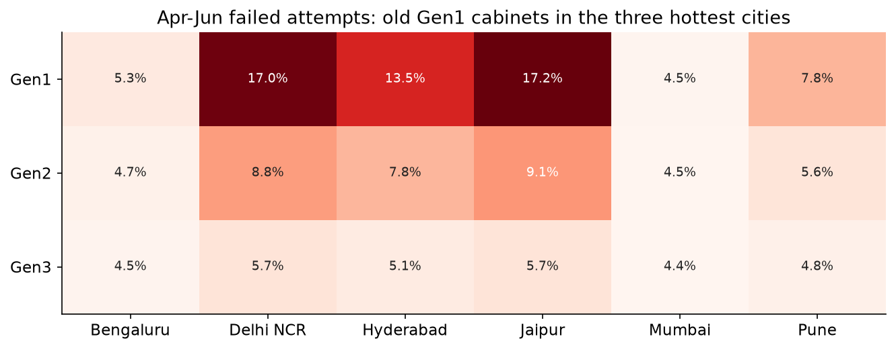
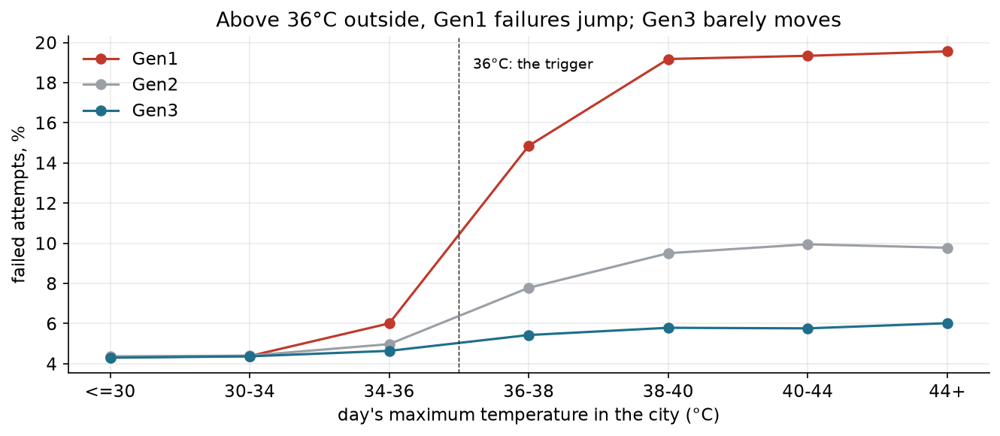
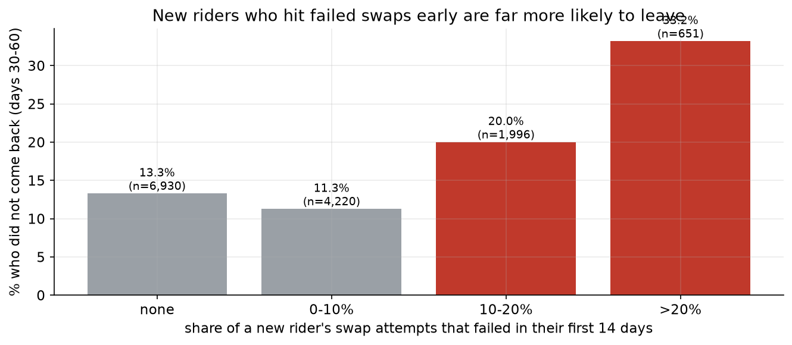
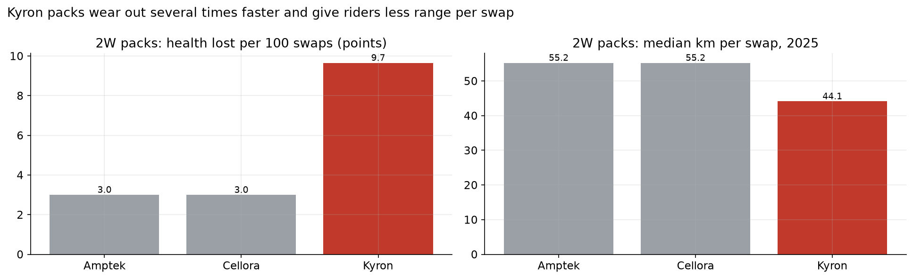
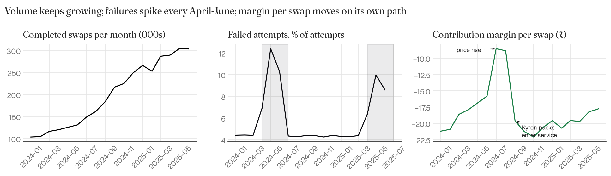
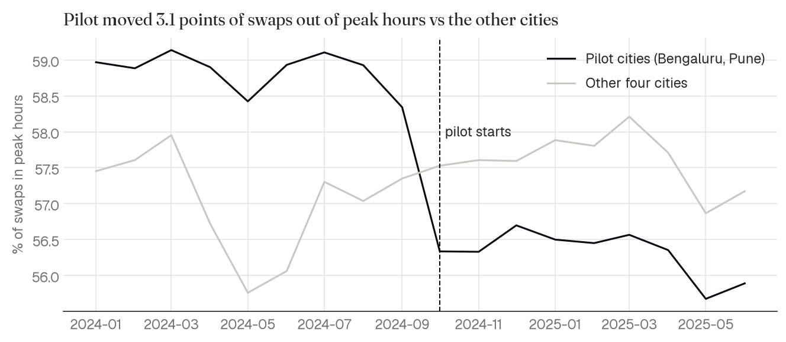
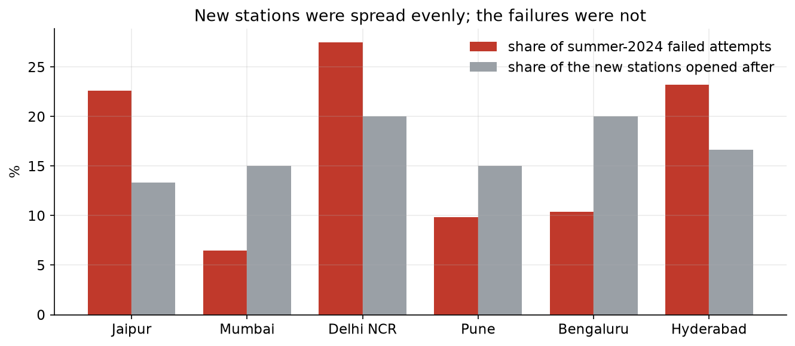

# Next April

The same 36 old swap cabinets will fail again next summer. This report shows which ones, why, what it costs, and what VoltRelay should fund instead of more stations.

Dhiraj Kavuri · Gradient Learnings Data Analytics Hackathon · 15 November 2026

## The answer in one page

Three numbers: **36** Gen1 cabinets in Jaipur, Delhi NCR and Hyderabad handled **27.4%** of summer 2025 swap attempts and produced **51.2%** of its failed attempts.

Every April to June, VoltRelay's oldest swap cabinets (Gen1) in the three hottest cities overheat, charge slowly and turn riders away. The empty shelf is a symptom, not the cause: at the same station and cabinet temperature, a Gen1 cabinet showing zero charged packs is no more likely to fail a rider for "no charged pack" than one showing packs in stock, so more packs or more stations will not fix it; fixing the cabinets will. Riders get turned away, and new riders who hit failed swaps early are the most likely to leave. A rule built from summer 2024 alone (each station gets the summer failure rate of its charger generation in its city) predicted summer 2025 for the 90 stations open both summers, with an out-of-sample R² of 0.990. The 60 stations VoltRelay opened in between were spread across all six cities and did not change it: the 36 failed on 15.9% of summer attempts in 2024 and 15.6% in 2025.

Margins have a different cause. Contribution margin per swap is negative once battery wear and station costs are counted, and the cost that rose most was wear from the new supplier, Kyron: its 2W packs wore out 3.22 times as fast as the others and cost ₹4.35 crore in extra wear before all 1,385 were written off. ZipDrop, the largest fleet partner, is the least profitable per swap after its discount rose from 12% to 28%.

What to fund, in order of money and certainty:

| # | Action | Owner | What it is worth | Confidence |
|---|---|---|---|---|
| 1 | Instead of more stations, fix the 36 Gen1 cabinets: replace them with Gen3, or retrofit cooling if a supplier can match Gen3's charge times in heat. The 23 in Jaipur and Delhi NCR before 1 April 2026, then the 13 in Hyderabad | Head of Network Ops | 27,193 fewer failed attempts a summer, 33.3% of all summer failures | High that failures repeat; medium on cost (not in the data) |
| 2 | Stop issuing "retired" Kyron packs today; replace the Kyron 2W fleet; claim on lots KY-2407/08/09 | Head of Fleet & Procurement | About ₹0.73 lakh of wear saved per 1,000 swaps moved off Kyron | Medium |
| 3 | Until the cabinets are fixed, protect new riders' first 14 days: on days forecast at 36°C or more, steer them to Gen2/Gen3 stations in the app | Head of Customer Experience | ₹16.4-65.4 lakh of revenue from riders kept | Medium |
| 4 | Reopen the ZipDrop contract instead of signing an exclusive | Head of Partnerships | Up to ₹11.78 per ZipDrop swap | High |
| 5 | Roll out peak pricing city by city as a revenue measure only | Head of Pricing | About ₹5.41 per swap; no effect on failures | Medium |
| 6 | Do not buy extra packs for the hot stations yet. If leadership wants to try, test 63 packs at 6 of the 36 stations, picked at random, against the other 30 this April | Head of Network Ops | Settles for ₹20.2 lakh whether a ₹1.37 crore buffer would work | Low that it helps: the data points against it |

## Problem Understanding

VoltRelay runs unmanned battery-swap cabinets for gig and logistics riders in six Indian cities. Between January 2024 and June 2025 completed swaps grew 2.93 times and revenue 3.18 times, but failed attempts grew 5.98 times. So the metrics do not tell the same story: volume and revenue rose steadily, failures spiked every April to June, and contribution margin per swap stayed negative (-₹18.39 in the first half of 2024, -₹19.21 in the first half of 2025, at a 70% battery replacement threshold). Leadership is about to choose between four budget proposals: more stations, more batteries, a network-wide pricing rollout, and a long-term exclusive with ZipDrop.

The data has one row per swap attempt, completed or not. An attempt fails when the cabinet has no charged pack (failed_no_charged_battery), the rider gives up in the queue (abandoned_queue), the rider cancels (cancelled_by_rider) or the system errors (failed_system_error). A failure rate here is all non-completed attempts divided by all attempts; in summer, 64.0% of failures at Gen1 stations and 56.8% at Gen3 stations were "no charged battery". Five changes happened during the period, and each has to be separated from the others: two expansion waves, a base price change in July 2024, a peak/off-peak pilot in Bengaluru and Pune from October 2024, the Kyron supplier, and the ZipDrop contract amendment on 1 November 2024.

## Data Cleaning

We checked every documented issue and found six the documentation does not mention. Every issue, the rows it affects, what we did and what it changes is in the notebook (section 2) and in `outputs/cleaning_table.csv`. The ones that change a result:

| Issue | Rows | What we did | Effect |
|---|---|---|---|
| Test stations (documented as "zero-value") | 62,031 | Excluded | They actually charged ₹39.3 lakh; keeping them overstates revenue |
| Firmware v3.2.0 clock 5h30 early, 10 Mar-14 Apr 2025 | 139,490 | Shifted back | Share of those swaps logged between midnight and 5 AM falls from 15.6% to 2.9%, matching the 3.0% elsewhere |
| Offline-sync near-duplicates | 1 | Searched three ways; nothing to remove | All 591,114 offline_batch rows kept |
| Odometer resets | 7,814 negative, 7,712 over 300 km | Set to missing | Range figures not distorted |
| City spellings | 585 riders, 21 spellings | Mapped to 6 cities | No phantom cities |
| CSAT missing more often for slow tickets | 28,871 tickets without a score | Re-weighted by resolution time | Naive 3.56 vs re-weighted 3.56: bias real but small here |
| Ticket categories not verified | 9,484 | Re-tagged every "other" ticket as a battery/range complaint: all carry one of three comments blaming the vehicle ("scooter weak lag raha hai aajkal", "bike problem", "vehicle performance") | Battery complaints were undercounted by 9,484 tickets |
| *Not documented:* payment_mode is the same on every row | 3,877,013 | Not used | Payment channel cannot be analysed |
| *Not documented:* packs issued before their ledger commission date | 1,011,084 | Pack age measured from first observed swap | Ledger dates are unusable for battery age |
| *Not documented:* Kyron packs issued after their retirement date | 36,277 | Kept, reported as an operations finding | "Retired" packs were still in riders' hands |

After excluding test stations, 3,814,982 attempts remain, 94.02% completed.

## Analytical Approach

| Core question | Method | Where |
|---|---|---|
| 1. Network performance over time | Monthly trends; contribution margin per swap = revenue minus grid energy, battery wear and station rent and upkeep | Notebook §3 |
| 2. Service failures | Failure rates by clock-corrected hour, season, vehicle class and station; failure type mix | §4 |
| 3. Stations and geography | Charger generation x city x season; hourly cabinet telemetry linked to attempts in the same station-hour; complaints per swap | §5 |
| 4. Battery and equipment | Health loss and km per swap by supplier and lot, from each pack's own swaps; ticket supplier mix | §6 |
| 5. Pricing and partners | Difference-in-differences for the pilot with an exact permutation test and a placebo; ZipDrop against other partners over the same months; margin per partner | §7 |
| 6. Retention | Churn on days 30-60 after the first swap; logistic regression with controls on all 13,797 new riders; checked on riders who started in 2025 | §8 |
| Will it happen again? | Back-test: a rule from summer 2024 scored out of sample on summer 2025 against two baselines | §10 |
| Budget decision, expansion waves, partner value, ticket text, anomalies | Verdicts on each proposal; where new stations went; partner margin; re-tagged tickets; Kyron and test-station anomalies | §6, §7, §10, §11 |

The notebook computes every number in this report and writes it to `facts.json`. A script fails if the report quotes a number that is not in that file, separate tests re-derive the headline numbers with their own queries, and section 12 recomputes the headlines under other reasonable choices.

## Key Insights

Which drivers are primary and which are secondary, for each outcome leadership asked about:

| Outcome | Primary driver (evidence) | Secondary drivers |
|---|---|---|
| Service failures | Gen1 cabinets in Jaipur, Delhi NCR and Hyderabad in April to June: 51.2% of summer 2025 failures from 27.4% of attempts; mechanism shown in telemetry | Evening rush after hot days; 3W vehicles fail more often all year |
| New-rider churn | Failed swaps in the first 14 days (16.4% of churned riders) and partner-billed plans (25.0%) | Kyron packs (5.9%), starting in April to June (4.3%); queue time not significant |
| Margin per swap | Battery wear from Kyron packs (₹4.35 crore extra) | ZipDrop's discount (₹39.6 lakh); price rise and cheaper energy pushed the other way |

### 1. Failures are a summer problem at old cabinets in hot cities
Outside April to June, all three charger generations fail on about 4.3% of attempts. In April to June, Gen1 fails on 12.9%, Gen2 on 5.8% and Gen3 on 5.1%. The Gen1-Gen3 gap is 7.8 points (95% interval 6.3 to 9.1, resampling stations so that attempts at one station are not treated as independent). By city, Jaipur (14.0%), Delhi NCR (12.6%) and Hyderabad (10.8%) lead. 36 of the 51 Gen1 stations are in those three cities. Complaints do not follow the same pattern: Gen1 and Gen3 stations draw about the same tickets per 10,000 swaps (117.6 and 120.6) and Gen2 fewer (94.5), so tickets alone would not have found this problem.

### 2. Cabinet telemetry shows why
At a cabinet temperature of 45°C or more, a Gen1 cabinet's average charge time rises from 88 to 156 minutes and it has no charged 2W pack in 37.3% of those hours (0.6% when cool). Gen3 cabinets reach the same temperatures and still charge in 43 minutes. In station-hours with no charged pack, 11.6% of attempts fail, against 5.9% when packs are in stock, which makes empty shelves look like the cause. They are not. Compare hours at the same station and the same cabinet temperature (145 station-by-temperature groups) and a Gen1 cabinet showing zero charged 2W packs is slightly less likely to fail a 2W rider for "no charged pack" (odds ratio 0.82, 95% interval 0.79 to 0.86). At 45°C or more, 9.27% of 2W attempts fail that way in empty hours against 10.85% in stocked ones, and 94.9% of these failures happen in hours when the cabinet showed charged 2W packs. Empty shelves and failures share a cause, the heat; adding packs to a cabinet that is too hot to serve them does not help. Summer failures peak in the evening rush (10.9% from 7 to 10 PM against 7.5% the rest of the day), after a hot day has drained stock. The 45°C point matches the upper charging limit commonly given for lithium-ion cells (0°C to 45°C, Battery University; outside context, not from the data).

The city weather data gives operations a forecast trigger. On days up to 34°C, Gen1 stations fail on 4.3% of attempts; above 38°C, on 19.4%, while Gen3 stays at 5.9%. The jump starts at a maximum temperature of 36°C, and in summer 2025 Jaipur had 80 such days, Delhi NCR 81, Hyderabad 60 and Mumbai none. City-wide grid outages add 2.1 points to a day's failure rate for every outage hour.

### 3. One rule predicts next summer, and expansion did not reach it
Give each station the summer 2024 failure rate of its charger generation in its city (leaving the station itself out), and you predict its summer 2025 rate with an out-of-sample R² of 0.990 and a typical error of 0.53 points, across the 90 of 150 stations open both summers. The network average predicts nothing (R² -0.003). Each station's own 2024 rate does almost as well (0.985), but within a group it adds no reliable signal (rank correlation 0.13, 95% interval -0.10 to 0.35), so the fix is the whole group, which the rule also covers for stations with no history. The 36 Gen1 stations in Jaipur, Delhi NCR and Hyderabad failed on 15.9% of summer attempts in 2024 and 15.6% in 2025, while their summer traffic grew from 172,800 to 267,903 attempts. The other 114 stations failed on 5.6% in summer 2025. The three hottest cities had 73% of summer 2024's failures but received 50% of the new stations.

On the brief's question of whether the waves went where riders needed them or where sites were easiest: Wave 1 mostly took easy sites, with 27 of its 30 stations at highway fuel pumps or in residential areas, the location types with the least demand; Wave 2 did better, putting 14 of 30 in markets. New stations handle 55.2 (Wave 1) and 60.5 (Wave 2) completed swaps a day against 69.2 at launch stations. Several did open near the failing cabinets, a median 1.22 km away, but they took no load off them: the 12 hot Gen1 stations with a new station within 1 km grew their summer traffic by 55.9% and failed on 16.4% of attempts, against 52.5% growth and 15.3% failures for the 24 farther away.

### 4. Early failures drive new riders away
New riders whose first 14 days had more than 20% failed attempts left at 33.2% (n=651), against 13.3% for those with none (n=6,930); the gap is 19.9 points (95% interval 16.3 to 23.7). With controls, every 10 points of early failure rate multiplies the odds of leaving by 1.41. Fitted on 2024 starters only, the model gives the same odds ratio (1.42) and ranks the 4,154 riders who started in 2025 with AUC 0.651, a modest score: useful for spotting groups at risk, not for picking individual riders. The shares of churn each factor accounts for are computed one factor at a time and do not add up to 100%. Survival curves show when the damage happens: riders with more than 20% early failures drop away in their first 30 days, and the gap then holds; 90 days after their first swap, 80.7% of riders with no early failures are still swapping against 70.8%. Partner-billed riders churn more with every partner, not just one (independents 13.1%), and the data has no field saying why, so we recommend reviewing onboarding with partners rather than guessing a cause.

### 5. Kyron packs are the margin problem
Kyron 2W packs lost 9.65 health points per 100 swaps against 2.99 for Cellora and 3.00 for Amptek (3.22 times as fast, 95% interval 3.21 to 3.24), and all three Kyron lots (KY-2407, KY-2408, KY-2409) degraded at the same rate, so this is the supplier, not one bad batch. Kyron packs gave a median 44.1 km per swap against 55.2, and all 1,385 were retired at 60.5% health. Their extra wear cost ₹4.35 crore, and heat made it worse: in 2025 Kyron packs came back at 74.9% health in the three hot cities against 77.0% elsewhere. The re-tagged "other" tickets confirm it from the riders' side: 33.5% of them name a Kyron pack, the same as low-range tickets (34.2%) and above both billing disputes (14.1%) and Kyron's 25.2% share of packs.

### 6. Pricing raised revenue without fixing service, and ZipDrop's discount is the costliest contract
The base price change in July 2024 did not reduce use: swaps per active rider per week went from 4.97 to 5.15 for independent riders and 6.15 to 6.31 for partner riders. The peak/off-peak pilot moved 3.1 points of swaps out of peak hours and added ₹5.41 per swap against the other cities; peak-hour failures did not fall (+0.57 points, not significant). Of the 15 ways to pick 2 pilot cities out of 6, the real pair shows the largest effect, which is the strongest result six cities allow (p = 0.067). A placebo test that pretends the pilot began in April 2024 finds +0.67 points (p = 0.015), so the cities were not perfectly parallel before; the effect is about five times that and in the other direction, but treat it as indicative. Against other partners over the same months, ZipDrop's amendment cut its revenue by ₹11.78 per swap (other partners moved +₹0.83), ₹39.6 lakh in 8 months, and in 2025 ZipDrop had the lowest margin per swap of any partner.

### 7. Anomalies
No station behaves unlike its own group: 0 stations sit more than 3 standard deviations from their group on failures, system errors, queue time or abandonment, which is why the fix is a whole group. The anomalies worth flagging are operational: Kyron packs issued 36,277 times after their recorded retirement, test stations that billed ₹39.3 lakh, and the 139,490 swaps logged 5h30 early by firmware v3.2.0.

## Supporting Visualizations

The chart for each insight sits next to it above. These cover the network as a whole; all charts are also in the notebook and in `outputs/charts/`.

## Business Findings

### What summer failures at Gen1 put at stake
Gen1 had 52,987 extra failed attempts across the two summers. Within 2 hours, 92% of riders whose swap failed had not completed a swap anywhere; within 24 hours, 44% still had not. Counting only those, about ₹15.0 lakh of revenue was at risk. The churn model attributes 98 lost new riders to early failures that happened at Gen1 in summer, worth ₹4.8 to ₹19.4 lakh of revenue at 3 to 12 months each.

### Margin per swap
Revenue per swap rose (₹59.89 to ₹64.77 between the first halves of 2024 and 2025), energy per swap fell (₹21.57 to ₹18.14) and station costs per swap fell with scale (₹18.06 to ₹11.68). Battery wear per swap rose from ₹38.64 to ₹54.16 when Kyron packs entered service. Contribution margin per swap was negative in both halves; whether it fell further depends on when a pack must be replaced, which the data does not say. At 70% health it went from -₹18.39 to -₹19.21; at 60% it improved; at 80% it fell further. Wear per swap rose under every threshold.

Money at stake, by kind: extra battery wear (a cost) ₹4.35 crore; ZipDrop's amendment (revenue given away) ₹39.6 lakh; summer failures at Gen1 (revenue at risk) ₹15.0 lakh; new riders lost (revenue at risk) ₹9.7 lakh at 6 months each.

## Actionable Recommendations

| # | Proposal | Verdict | Do this | Owner | Effect | Confidence |
|---|---|---|---|---|---|---|
| 1 | More stations | Not as proposed | Fix the 36 Gen1 cabinets instead: replace them with Gen3, or retrofit cooling if a supplier can match Gen3's charge times in heat. The 23 in Jaipur and Delhi NCR before 1 April 2026, then the 13 in Hyderabad | Head of Network Ops | If they had failed like Gen3 stations in their own cities, summer 2025 would have had 27,193 fewer failed attempts, 33.3% of all summer failures, taking them from 15.6% to 5.5%. Revenue alone protects ₹7.7 lakh a summer (about ₹0.4 lakh per station), so the case is service and riders kept, not revenue | High that failures repeat; medium on the cost of the fix |
| 2 | More batteries | Yes, to replace Kyron; not as extra stock | Stop issuing retired Kyron packs; replace the Kyron 2W fleet; claim on lots KY-2407/08/09. Do not add packs at the hot stations: at the same station and temperature, empty cabinets do not fail riders more often. A buffer sized from the data's own charge times would need 427 packs (₹1.37 crore) for a 95% chance of a pack at each station's busiest hot hour; if leadership wants to try it, test 63 packs at 6 of the 36 stations, picked at random, against the other 30 (₹20.2 lakh) | Head of Fleet & Procurement | ₹0.73 lakh of wear saved per 1,000 swaps moved off Kyron; replacing the 2W fleet costs about ₹4.43 crore | Medium (wear depends on the replacement threshold) |
| 3 | Not in the four proposals: new-rider retention | Add | Until the cabinets are fixed, on days forecast at 36°C or more, steer riders in their first 14 days to Gen2/Gen3 stations in the app; review onboarding with fleet partners | Head of Customer Experience | 330 new riders lost to early failures; ₹16.4-65.4 lakh of revenue if kept 3 to 12 months each | Medium (observational) |
| 4 | ZipDrop exclusive | No | Reopen the contract: bring the discount back toward the 12% it had and add the peak surcharge | Head of Partnerships | Up to ₹11.78 per ZipDrop swap | High |
| 5 | Network-wide pricing | Yes for revenue, not for service | Roll out city by city and measure each city against the others, as in the pilot | Head of Pricing | About ₹5.41 more per swap | Medium (6 cities) |

### The April 2026 list
Wave 1 is the 23 Gen1 stations in Jaipur and Delhi NCR, with 21,265 excess failed attempts in summer 2025. Wave 2 is the 13 Gen1 stations in Hyderabad, with 9,086. All are original launch stations. The four Gen1 stations in Pune failed on 7.8% of summer attempts and come next if budget allows. The full list, with each station's summer and non-summer failure rates, is in `outputs/april_2026_list.csv`.

### How to tell it worked
Use a forecast maximum of 36°C in Jaipur, Delhi NCR or Hyderabad as the trigger for steering new riders. Track, from April 2026, the summer failure rate at each fixed station against those not yet fixed (target: near the 5.6% of the other stations), average charge time at 45°C or more (target: Gen3's 43 minutes), the share of new riders with any failed swap in their first 14 days, and Kyron's share of packs issued (target: zero).

## Limits

- This is observational data. The heat mechanism is shown in the telemetry, and the back-test shows the pattern repeats, but no experiment was run, and the back-test covers one train summer and one test summer.
- Cabinet upgrade and cooling prices are not in the data. The upgrade effect assumes a fixed cabinet performs like the Gen3 cabinets already running in the same city.
- Contribution margin is negative, so swaps saved are counted as revenue at risk, not profit.
- Battery wear depends on an assumed replacement threshold (70% health, within the 70-80% range commonly used for EV packs); section 12 of the notebook shows 60% and 80%.
- The stock test uses each station-hour's minimum charged count from telemetry, not the shelf at the moment of each attempt. That is why we propose a small test before ruling a buffer out for good, rather than ruling it out on this data alone.
- The pricing pilot has six cities: its pre-period was not perfectly parallel, and the permutation test cannot go below p = 0.067.
- The churn model ranks risk modestly (AUC 0.651 on unseen riders).

## AI use

An AI coding assistant (Claude) helped write queries and code, draft text and search public sources. Every number was checked outside the AI's own reasoning: the notebook writes each number to `facts.json`, separate tests re-derive the headline numbers with independent queries, a fresh re-derivation from the problem statement alone confirmed the key facts, a separate reviewer audited the analysis against the brief, and a script fails if this report quotes a number not in `facts.json`. Mistakes caught this way include a first version of the pilot's peak hours, blank pack IDs read as text, a bootstrap that changed between runs, and a "lost swaps" figure that ignored riders who swapped later the same day. The judgement calls (replacement threshold, value of a lost rider) are ours and are stated above.
